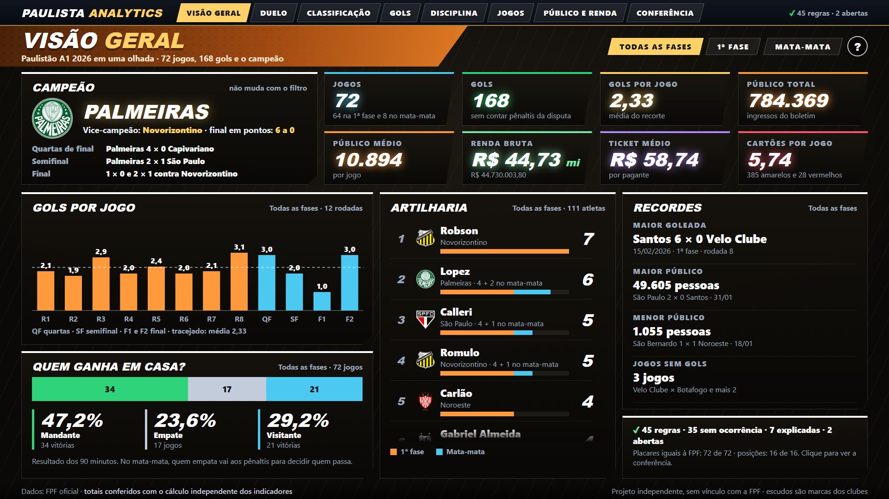
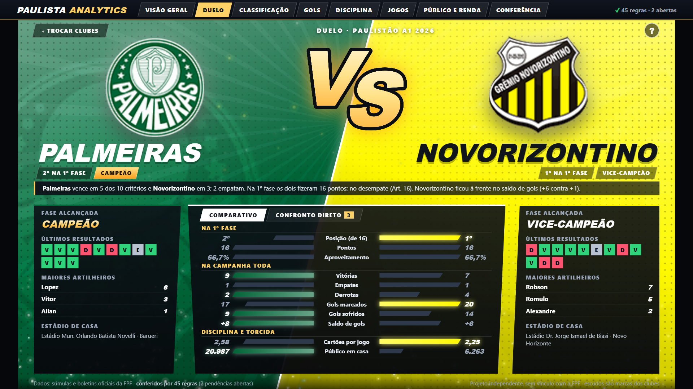
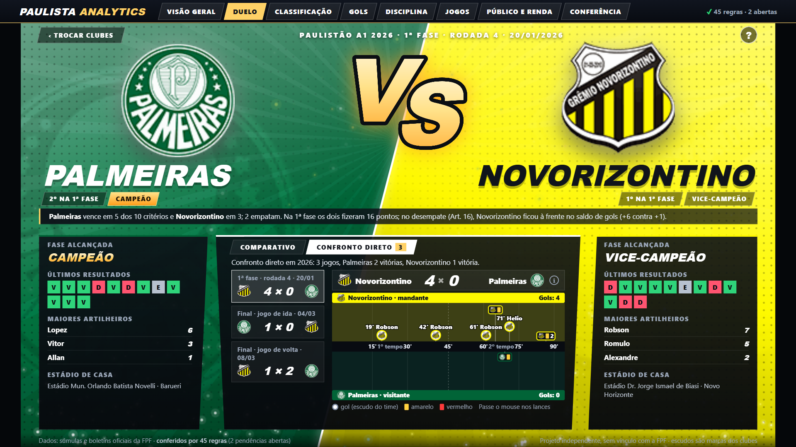
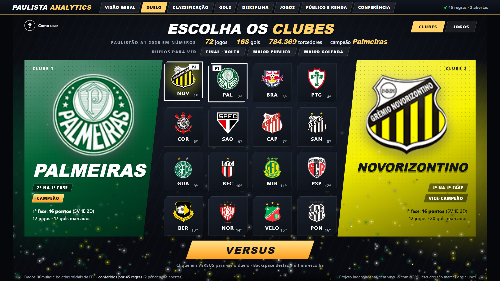
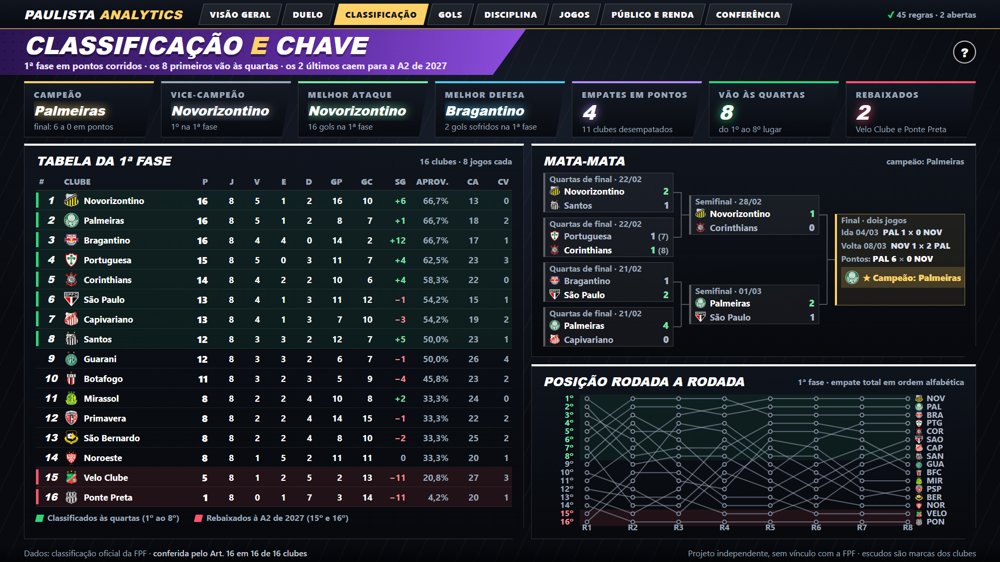
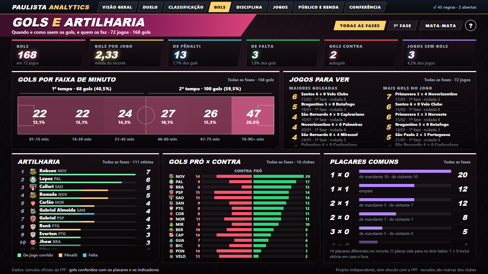
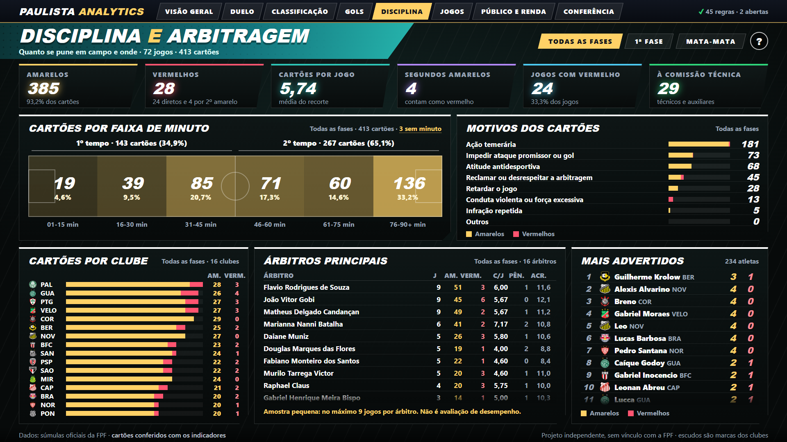
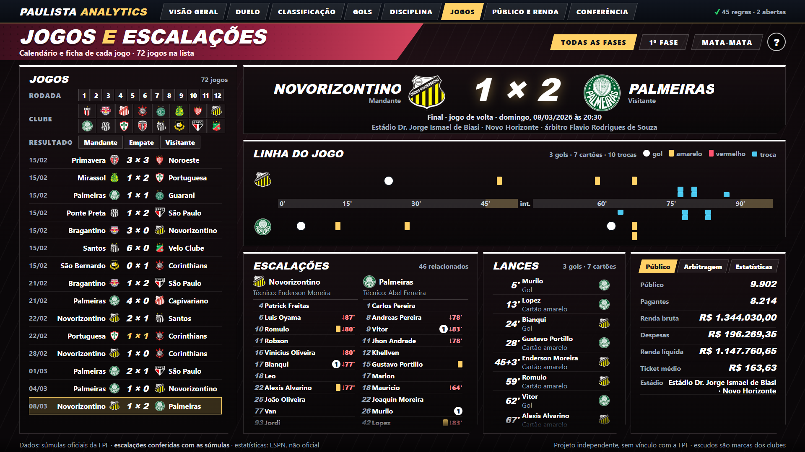
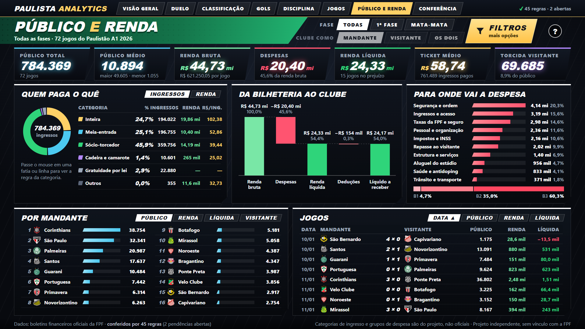
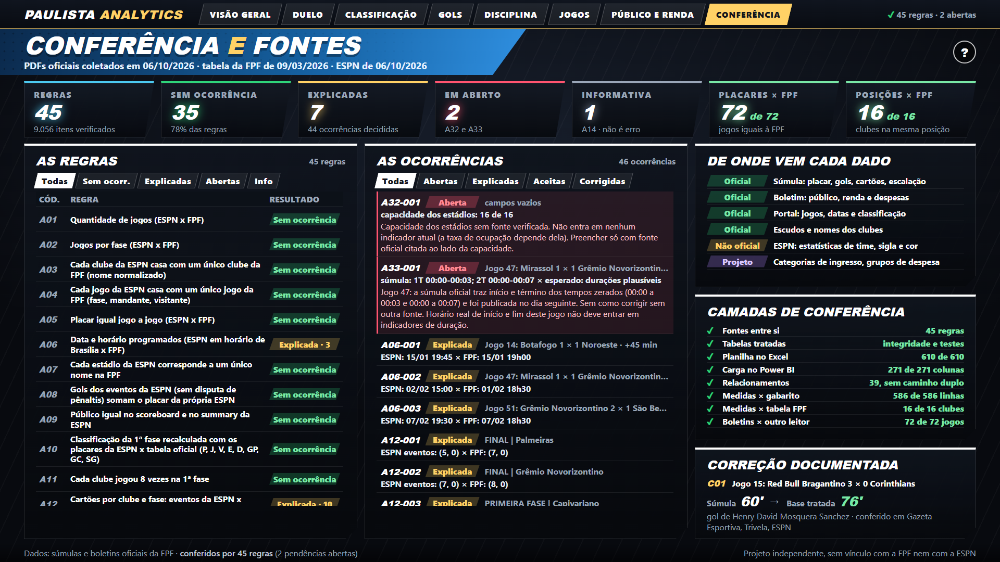

<div align="center">

</div>

<div align="center">

# ⚽ Paulista Analytics — Painel do Paulistão A1 2026

**Painel do Campeonato Paulista A1 2026 em Power BI, com a interface inteira em HTML, CSS e JavaScript**
desenhada dentro do visual HTML Content e alimentada por medidas DAX. Por trás dele, uma base lida das
**súmulas e dos boletins financeiros oficiais da FPF** e conferida contra a tabela e a classificação
oficiais.

[](https://app.powerbi.com/view?r=eyJrIjoiOTQ4ZjgwMTgtNTg3Ny00NmFkLThhMTYtYzQ2MTIwZmRiMWU5IiwidCI6IjY1OWNlMmI4LTA3MTQtNDE5OC04YzM4LWRjOWI2MGFhYmI1NyJ9&pageName=7c7269fdd5373189ce13)
[](https://github.com/victor-ozores/Paulista-Analytics)
[](./LICENSE)

[](https://linkedin.com/in/victor-ozores/)
[](https://app.xperiun.com/in/victor-ozores-2)
[](https://github.com/victor-ozores)

</div>

---

## 📌 Resumo

Projeto de portfólio para a vaga de **Estagiário de Análise de Dados do Departamento de Competições da
Federação Paulista de Futebol**: um painel que responde, em oito telas, às perguntas que o Departamento
faz sobre um campeonato (classificação, gols, disciplina, arbitragem, público e renda) e que mostra, na
própria tela, de onde vem cada número e o que ficou sem resposta.

**Resultado do Paulistão A1 2026:** 72 jogos, **168 gols** (2,33 por jogo), **413 cartões**
(385 amarelos e 28 vermelhos), **784.369 pessoas** no público e **R$ 44,73 milhões** de renda bruta.
**Palmeiras campeão** (final contra o Novorizontino: 1 × 0 e 2 × 1), **Robson** artilheiro com 7 gols.
A 1ª fase termina com três clubes empatados em 16 pontos (Novorizontino, Palmeiras e Bragantino); o
desempate pelo Art. 16 do regulamento coloca o Novorizontino em 1º (saldo de gols de +6 contra +1 do
Palmeiras) e o Bragantino, com menos vitórias, em 3º.

> Projeto independente, sem vínculo com a Federação Paulista de Futebol nem com a ESPN. Usa documentos
> públicos. Os escudos são marcas dos clubes.

## 🔗 Ver Dashboard Online

[](https://app.powerbi.com/view?r=eyJrIjoiOTQ4ZjgwMTgtNTg3Ny00NmFkLThhMTYtYzQ2MTIwZmRiMWU5IiwidCI6IjY1OWNlMmI4LTA3MTQtNDE5OC04YzM4LWRjOWI2MGFhYmI1NyJ9&pageName=7c7269fdd5373189ce13)

A barra no topo troca de tela. Em todas, passar o mouse em qualquer número, barra ou botão mostra uma
dica que explica o que ele é e de onde vem.

---

## 💡 O Que Ele Responde

Uma pergunta por tela:

- **Visão geral** — Como foi o Paulistão em uma olhada?
- **Duelo** — Como um clube se compara com outro?
- **Classificação e chave** — Quem passou, quem caiu e como?
- **Gols e artilharia** — Quando e como saem os gols, e quem os faz?
- **Disciplina e arbitragem** — Quanto se pune em campo, quando, por quê, quem e com que árbitro?
- **Jogos e escalações** — O que aconteceu em cada jogo e quem jogou?
- **Público e renda** — Quanto público e quanto dinheiro o campeonato fez?
- **Conferência e fontes** — Dá para confiar nestes números?

## 📊 Páginas do Dashboard

| Tela | O que mostra |
|---|---|
| **Visão geral** | Campeão e caminho até o título, oito números do campeonato, gols por jogo em cada rodada, quem ganha em casa, artilharia e recordes |
| **Duelo** | Dois clubes lado a lado: comparativo em 10 critérios, confronto direto com os gols e cartões de cada jogo no campo, forma e artilheiros |
| **Classificação e chave** | Tabela da 1ª fase com o desempate do Art. 16 explicado, mata-mata com a final em dois jogos e a posição de cada clube rodada a rodada |
| **Gols e artilharia** | Gols por faixa de minuto, maiores goleadas, artilharia, gols pró × contra e placares mais comuns |
| **Disciplina e arbitragem** | Cartões por minuto, por motivo (oito grupos), por clube, por atleta e árbitros principais, com aviso de amostra pequena |
| **Jogos e escalações** | Os 72 jogos com linha do tempo, titulares, banco, trocas, lances, público e renda, arbitragem e estatísticas |
| **Público e renda** | Ingressos por categoria, da bilheteria ao clube (cascata), despesas por grupo, ranking por mandante e lista de jogos |
| **Conferência e fontes** | As 45 regras de conferência, as ocorrências, de onde vem cada dado e as camadas de conferência |

## 🔎 Qualidade dos Dados

- **45 regras de conferência** comparam as fontes entre si e com a tabela e a classificação oficiais da
  FPF. Cada divergência vira um registro com status e explicação, visível na tela Conferência.
- **Classificação com o desempate do Art. 16** igual à tabela oficial nos 16 clubes; cartões pela regra
  da FPF (o segundo amarelo conta como vermelho).
- **59 indicadores** com definição e valor de referência: as medidas DAX do modelo reproduzem todos.
- **Planilha Excel** que refaz indicadores, classificação, artilharia, financeiro e elenco por fórmula.
- **590 testes automáticos**, inclusive o JavaScript de cada tela rodando com os dados reais.

## 📸 Preview

<div align="center">

<br><br>

<br><br>

<br><br>

<br><br>

<br><br>

<br><br>

<br><br>

<br><br>

<br><br>

</div>

<details>
<summary><b>⚙️ Detalhes Técnicos</b></summary>

### Arquitetura

```
súmulas e boletins (PDF, FPF) ─► leitura em Python ─► 20 tabelas ─► 45 regras de conferência
tabela e classificação da FPF ──────────────────────────────────────────┘        │
                                                                                  ▼
                         Excel de conferência ◄── tabelas e indicadores de referência ──► modelo do Power BI
                                                                                  │       (23 tabelas, 39 relacionamentos,
                                                                                  │        72 medidas DAX)
                                                                                  ▼
                              115 medidas montam a página HTML com as oito telas no visual HTML Content
```

- **Modelo do Power BI** em estrela, no formato PBIP (texto, que o Git versiona), em `powerbi/`: 23
  tabelas, 39 relacionamentos e 72 medidas DAX. Abra `powerbi/PaulistaAnalytics.pbip` no Power BI
  Desktop com o visual **HTML Content completo** (a versão "lite" remove o JavaScript e não serve).
- **Cada tela é um fragmento HTML** em `prototype/<tela>/fragmento.html`. As oito telas e a barra de
  navegação formam uma página só, que vai na medida `html_dashboard`: o código e os dados de cada tela
  ficam em pedaços de até 8.000 caracteres (115 medidas, 786 mil caracteres) e uma medida final junta tudo.
- **Nada externo na interface**: nenhuma fonte, biblioteca ou imagem de fora; os escudos vão embutidos.
- **Scripts** em `scripts/`: leitura dos PDFs, tratamento, regras de conferência, Excel de conferência,
  geração do modelo e das telas.

### Indicadores calculados

59 indicadores definidos em [`docs/dicionario_indicadores.md`](./docs/dicionario_indicadores.md), cada um
com fórmula, valor de referência em Python e medida DAX. Alguns exemplos:

| Indicador | Fórmula |
|---|---|
| Cartões por jogo | (amarelos + vermelhos) / jogos, com a regra da FPF: segundo amarelo conta como vermelho |
| Aproveitamento | pontos / (3 × jogos) |
| Ticket médio | renda bruta / ingressos pagos |
| Renda líquida | renda bruta − despesas (B1 + B2 + B3 do boletim) |
| Gols por faixa de minuto | gols de cada faixa de 15 min, com os acréscimos na última de cada tempo |
| Posição na 1ª fase | pontos, vitórias, saldo de gols, gols marcados, menos vermelhos, menos amarelos e sorteio (Art. 16) |

### Stack

- **Python + pandas + pypdf** — leitura dos PDFs, tratamento, regras de conferência e testes
- **openpyxl + Excel** — planilha de conferência com fórmulas vivas
- **Power BI Desktop + DAX + Power Query** — modelo em estrela, relacionamentos e medidas documentados
- **HTML + CSS + JavaScript puros** dentro do visual **HTML Content** — as oito telas, sem biblioteca
- **pytest + Node** — testes
- **Playwright** — só para tirar os prints deste README

### Dados e confidencialidade

Os dados vêm de documentos públicos da FPF (súmulas e boletins financeiros em PDF, tabela e
classificação do portal) e, só para estatísticas de time, da ESPN (não oficiais, sempre rotuladas). **Os
dados coletados e as tabelas geradas não estão neste repositório.** Não há CPF, telefone ou e-mail: o
painel mostra nome de atleta, comissão técnica e árbitro como na súmula, e o motivo do cartão aparece só
em oito grupos, nunca como o texto livre da súmula.

A licença MIT cobre o código e a documentação. Os escudos são marcas dos clubes, e os documentos oficiais
são da FPF.

### Limitações conhecidas

- **Taxa de ocupação dos estádios**: não há capacidade com fonte oficial verificada, então nenhuma tela
  mostra ocupação.
- **Horários do jogo 47**: a súmula veio com os horários dos tempos zerados e não há outra fonte; os
  acréscimos informados valem.
- **Dados da ESPN**: só estatísticas de time (posse, finalizações...), as 15 cobranças da disputa de
  pênaltis e a sigla e a cor dos clubes, sempre rotulados "ESPN, não oficial". O placar da disputa de
  pênaltis é o da súmula.
- **Categorias de ingresso (6), grupos de despesa (10) e grupos de motivo de cartão (8)** são
  classificações do projeto, não oficiais.
- **Árbitros não são avaliados**: a tela mostra o que aconteceu nos jogos de cada um, com o aviso de que
  a amostra é pequena (no máximo 9 jogos por árbitro).
- **Nomes curtos dos atletas** são uma aproximação (primeiro nome mais último sobrenome); o nome
  completo aparece na dica.
- Dataset de uma única competição e estático: o painel não recebe dados novos sozinho.

### Estrutura do repositório

```
README.md, LICENSE, requirements.txt
/powerbi               → projeto do Power BI em PBIP (modelo, medidas DAX e relatório)
/prototype             → um fragmento HTML por tela e a barra de navegação (shell.html)
/scripts               → leitura dos PDFs, tratamento, regras, Excel, geração do modelo e das telas
/tests                 → pytest e harnesses em Node
/data/referencia       → referência oficial pequena e listas de categorias e grupos
/docs                  → modelo, medidas, indicadores, contrato de dados e os prints deste README
```

### Documentação

| Documento | Conteúdo |
|---|---|
| [`docs/modelo_powerbi.md`](./docs/modelo_powerbi.md) | Relacionamentos e tabelas do modelo do Power BI |
| [`docs/medidas_dax.md`](./docs/medidas_dax.md) | As 72 medidas DAX, em pastas, com a fórmula de cada uma |
| [`docs/powerquery.md`](./docs/powerquery.md) | Como o Power BI carrega cada tabela |
| [`docs/contrato_dados.md`](./docs/contrato_dados.md) | Tabelas e colunas |
| [`docs/dicionario_indicadores.md`](./docs/dicionario_indicadores.md) | O que cada indicador significa e como é calculado |

Construído com o **Claude Code** como assistente de programação.

</details>

---

<div align="center">

Feito por **Victor Ozores** · [GitHub](https://github.com/victor-ozores)

</div>
